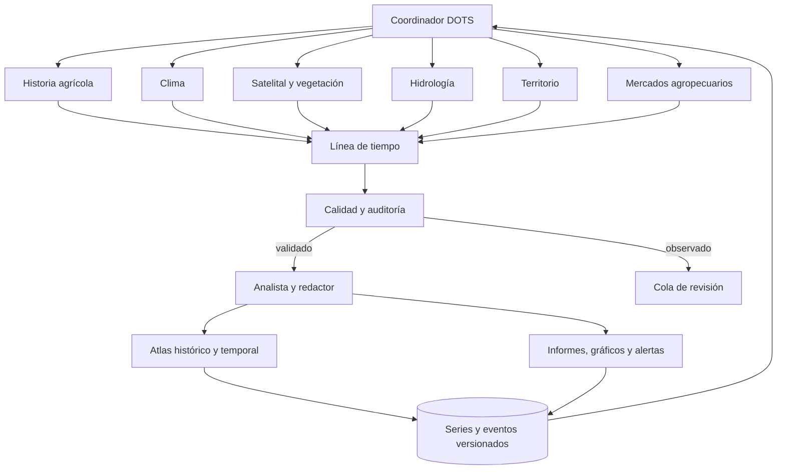

# DOTS — mapa de agentes propios y operación continua

## Objetivo

DOTS debe investigar, actualizar, contrastar y publicar información agroterritorial de forma continua. Los agentes no son personajes de chat: son procesos de software con tareas, fuentes, calendarios, resultados, memoria de ejecución y controles.

## Mapa de coordinación

## Alcance territorial

DOTS es un observatorio agroterritorial sudamericano. La primera cobertura comprende Argentina (provincias y regiones productivas), Brasil (estados y regiones), Uruguay (departamentos) y Paraguay (departamentos). La incorporación de otros países será gradual. No se incluyen penínsulas europeas ni regiones fuera de Sudamérica.

## Agentes y tareas

| Agente | Trabajo propio | Ritmo objetivo | Producto |
|---|---|---|---|
| Coordinador | Distribuye tareas, controla dependencias y reintentos | Cada ciclo | Estado y cola de trabajo |
| Historia agrícola | Siembra, cosecha, producción y rendimiento | Mensual / nueva publicación | Series históricas |
| Clima | Lluvia, temperatura, anomalías y sequías | Diario | Series y anomalías |
| Satelital y vegetación | Sentinel, Landsat, MODIS, radar, NDVI/EVI y cobertura | Nueva escena | Observaciones y mapas |
| Hidrológico | Ríos, caudales, humedad, inundaciones | Diario / eventos | Series y alertas |
| Territorial | Provincia, partido, cuenca y región productiva | Semanal | Indicadores y capas |
| Mercados | Precios, exportaciones y comercio | Diario / publicación | Series de mercado |
| Línea de tiempo | Une hitos y series con fecha, escala y territorio | Ante cada actualización | Eventos y series temporales |
| Calidad y auditoría | Unidades, cobertura, fuente, fecha, duplicados y faltantes | Antes de publicar | Dictamen de calidad |
| Analista y redactor | Tendencias, comparaciones y explicación | Diario / evento | Informes y gráficos |

## Reglas de funcionamiento

1. Cada tarea tiene identificador, agente responsable, fecha de ejecución, frecuencia, estado, fuente y próxima ejecución.
2. Cada dato conserva fuente original, URL, fecha de consulta, fecha de observación, unidad, cobertura geográfica y método de transformación.
3. Separar dato observado, estimación, pronóstico, reconstrucción histórica e interpretación.
4. No rellenar faltantes con valores inventados. No convertir una ausencia de dato en cero.
5. El agente de calidad bloquea publicaciones con unidades incompatibles, fechas inválidas o procedencia insuficiente.
6. Si dos fuentes discrepan, conservar ambas observaciones y explicar diferencias; no promediar automáticamente.
7. Los agentes pueden investigar y preparar publicaciones automáticamente. Las alertas públicas sensibles o conclusiones extraordinarias requieren revisión humana.
8. Cada ciclo deja log, versión de datos y resultado reproducible.

## Estado de implementación

- [x] Definición de agentes, responsabilidades, entradas y salidas.
- [x] Mapa de coordinación y reglas de evidencia.
- [ ] Adaptadores históricos de FAOSTAT y estadísticas agropecuarias argentinas.
- [ ] Almacenamiento persistente de series/eventos con versionado.
- [ ] Planificador programado y cola de tareas.
- [ ] Panel de actividad y última ejecución por agente.
- [ ] Publicación automática de series validadas en el Atlas.
- [ ] Pruebas de integración y despliegue.

**Importante:** que un agente figure en el registro no significa que ya esté ejecutándose. El estado pasa a activo sólo cuando su adaptador, tarea programada y última ejecución exitosa estén comprobados.
